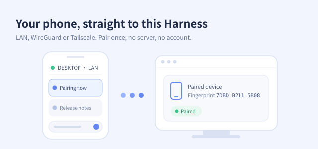

Choose **Pair a device** below. Scan the QR code with dsh-Go, then allow the phone on the computer once both screens show the same six-digit code.

The same panel lists paired devices with their status, address and latency, and removes them.
